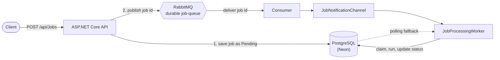
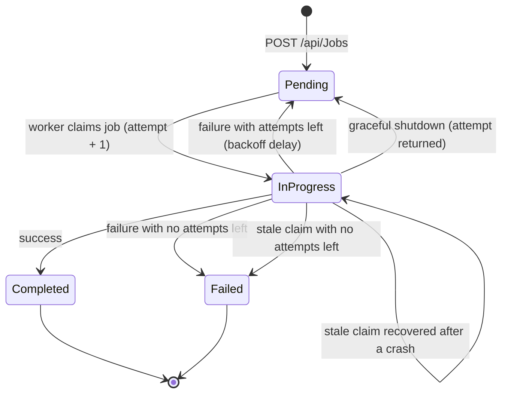

<h1 align="center">Job Queue System</h1>

<p align="center">
  A background-job service built with ASP.NET Core, PostgreSQL and RabbitMQ.<br/>
  Retries with backoff · crash recovery · safe concurrent workers · health checks and metrics
</p>

<p align="center">
  
  
  
  
  <a href="https://github.com/geep97/JOB-QUEUE-SYSTEM/actions"></a>
</p>

<p align="center">
  <a href="https://jobqueue-api.onrender.com/swagger"><b>Live demo (Swagger)</b></a> ·
  <a href="#architecture">Architecture</a> ·
  <a href="#how-a-job-is-processed">How it works</a> ·
  <a href="#design-decisions">Design decisions</a> ·
  <a href="#known-limitations">Limitations</a>
</p>

---

## Why this project

Slow work such as sending an email or syncing data should not block an API request. This service accepts a job, stores it, and returns immediately. A background worker then processes it, and the system has to keep that promise when workers crash, restart, run in parallel, or fail.

The point of the project is not the API. It is the failure handling around it.

## Highlights

- **Fast, non-blocking API.** `POST /api/Jobs` stores the job and returns `201 Created` with the job ID.
- **RabbitMQ notifications** with a durable queue, so workers hear about new jobs without constantly asking the database.
- **Retries with backoff.** Failed jobs wait longer before each new attempt, and give up after a configurable number of attempts.
- **Crash recovery.** A job abandoned mid-run by a dead worker is picked up again, or marked `Failed` if it has no attempts left.
- **Safe concurrent workers.** Optimistic concurrency stops two workers from processing the same job.
- **Graceful shutdown.** A job interrupted by a deployment is returned to the queue without using up one of its attempts.
- **Production basics.** Health checks, Prometheus metrics, structured logs, Docker, and CI.

## Architecture



- **PostgreSQL is the source of truth.** Status, attempts, errors and timestamps all live there.
- **RabbitMQ carries only a signal** (the job ID), so the broker never holds data that the database does not.
- **The worker keeps a polling fallback.** If a message is lost or never published, the job is still found and processed.

## How a job is processed



| Rule | Behavior |
|---|---|
| Maximum attempts | Configurable through `JobQueueSettings:MaxRetries` (default `3`) |
| Backoff | Increasing delay after each failure, stored in `ProcessAfter` |
| Dead-letter state | A job that exhausts its attempts ends as `Failed`, with the last error kept in `errors` |
| Stale claims | A job stuck in `InProgress` past the lock timeout is treated as abandoned by a crashed worker |
| Shutdown | An interrupted job goes back to `Pending` and does not lose an attempt or record a fake error |
| Delivery guarantee | **At-least-once.** A job can run more than once, so handlers must be safe to repeat |

## Design decisions

| Decision | Why |
|---|---|
| Database holds the truth, broker holds a signal | One place to look for state, and a lost message cannot lose a job |
| Optimistic concurrency (row version) instead of locks | Workers never block each other, and a collision simply makes one worker skip the job |
| Keep polling alongside RabbitMQ | Covers missed messages while the system has no transactional outbox |
| Separate "job failed" from "app is shutting down" | Deployments must not eat a job's retry budget |
| Backoff on retry | Hammering a failing dependency three times in a row rarely helps |
| Controller → service → repository layering | Rules can change without touching HTTP or storage code, and are easy to test |
| Scoped database context per worker iteration | A long-lived worker must not hold one short-lived `DbContext` forever |

## Tech stack

| Area | Technology |
|---|---|
| Language and framework | C#, ASP.NET Core, .NET 10 |
| Data | Entity Framework Core, Npgsql, PostgreSQL on Neon |
| Messaging | RabbitMQ on CloudAMQP |
| Observability | Serilog, OpenTelemetry, Prometheus exporter |
| Quality | xUnit, GitHub Actions |
| Delivery | Docker (multi-stage image), Render |
| Docs | Swagger / OpenAPI |

## API

| Method | Endpoint | Description |
|---|---|---|
| `POST` | `/api/Jobs` | Create a job |
| `GET` | `/api/Jobs` | List jobs |
| `GET` | `/api/Jobs/{id}` | Get one job |
| `PUT` | `/api/Jobs/{id}/status` | Update a job's status |
| `GET` | `/health` | Liveness check |
| `GET` | `/health/ready` | Readiness check (database connection) |
| `GET` | `/metrics` | Prometheus metrics |

**Status values**

| Value | Meaning |
|---|---|
| `0` | Pending |
| `1` | InProgress |
| `2` | Completed |
| `3` | Failed |

### Example

```bash
curl -X POST https://jobqueue-api.onrender.com/api/Jobs \
  -H "Content-Type: application/json" \
  -d '{"type":"NormalJob","payload":"Email"}'
```

```json
{
  "id": 1,
  "type": "NormalJob",
  "payload": "Email",
  "status": 0,
  "attempts": 0,
  "errors": null,
  "createdAt": "2026-10-24T15:19:56.6709014Z",
  "claimedAt": null,
  "processAfter": "2026-10-24T15:19:56.6709222Z",
  "rowVersion": "c74bdf9c-8f77-4785-b146-00a1a2d77464"
}
```

Then check on it:

```bash
curl https://jobqueue-api.onrender.com/api/Jobs/1
```

> The demo runs on a free hosting tier, so the first request after a quiet period can be slow while the service wakes up.

## Try the failure handling

Job execution is **simulated**: handlers wait a few seconds, and any job whose type contains `Fail` throws on purpose. That makes the retry behavior easy to watch.

1. Create a job with `"type": "NormalJob"`. It should move `Pending → Completed` with `attempts: 1`.
2. Create a job with `"type": "FailJob"`. Poll `GET /api/Jobs/{id}` and watch `attempts` rise while the delay between tries grows. After the last attempt, its status becomes `Failed` and `errors` holds the reason.

## Observability

- **Logs:** structured logs through Serilog.
- **Metrics:** OpenTelemetry instrumentation exposed at `/metrics` in Prometheus format.
- **Health:** `/health` for liveness, `/health/ready` to confirm the database is reachable.

## Getting started

### Prerequisites

- [.NET 10 SDK](https://dotnet.microsoft.com/download/dotnet/10.0)
- A PostgreSQL database (a free [Neon](https://neon.tech) database works)
- A RabbitMQ instance (a free [CloudAMQP](https://www.cloudamqp.com) plan works)
- Docker Desktop (optional, only for building the container image)

### 1. Clone

```bash
git clone https://github.com/geep97/JOB-QUEUE-SYSTEM.git
cd JOB-QUEUE-SYSTEM
```

### 2. Configure secrets

Never commit connection strings or passwords. Locally, use .NET user secrets:

```bash
dotnet user-secrets init --project JobQueue/JobQueue.csproj

dotnet user-secrets set "ConnectionStrings:DefaultConnection" "Host=YOUR_HOST;Database=YOUR_DB;Username=YOUR_USER;Password=YOUR_PASSWORD;SSL Mode=Require" --project JobQueue/JobQueue.csproj

dotnet user-secrets set "RabbitMq:Url" "YOUR_RABBITMQ_URL" --project JobQueue/JobQueue.csproj
```

In production, use environment variables instead:

| Variable | Description |
|---|---|
| `ConnectionStrings__DefaultConnection` | PostgreSQL connection string |
| `RabbitMq__Url` | RabbitMQ connection URL |

### 3. Apply migrations

```bash
dotnet ef database update --project JobQueue/JobQueue.csproj
```

### 4. Run

```bash
dotnet run --project JobQueue/JobQueue.csproj
```

Swagger is available in the Development environment at `/swagger`.

### 5. Test

```bash
dotnet test JobQueue/JobQueue.Tests/JobQueue.Tests.csproj --configuration Release
```

### 6. Build the Docker image (optional)

```bash
docker build -t jobqueue-api -f JobQueue/Dockerfile .

docker run -p 8080:8080 \
  -e "ConnectionStrings__DefaultConnection=YOUR_POSTGRES_CONNECTION_STRING" \
  -e "RabbitMq__Url=YOUR_RABBITMQ_URL" \
  jobqueue-api
```

## Project structure

```
JOB-QUEUE-SYSTEM/
├── .github/workflows/     CI: restore, build, test, Docker build
└── JobQueue/
    ├── Controllers/       HTTP layer
    ├── Services/          business rules and job state changes
    ├── Workers/           background job processing
    ├── Data/              EF Core DbContext
    ├── Migrations/        database schema history
    ├── Models/  DTOs/     entities and request shapes
    ├── Dockerfile
    ├── Program.cs         startup and dependency registration
    └── JobQueue.Tests/    xUnit tests
```

## CI/CD and deployment

- **CI:** GitHub Actions restores dependencies, builds the API, runs the tests, and builds the Docker image on every push and pull request.
- **Deployment:** the Docker image is deployed to Render, with PostgreSQL on Neon and RabbitMQ on CloudAMQP. All credentials come from environment variables.

## Known limitations

These are deliberate scope decisions, and they are the next steps.

- **No transactional outbox.** Saving the job and publishing its message are two separate steps. If the app crashes between them, the job has no message, and the polling fallback is what rescues it.
- **Polling still runs** alongside RabbitMQ, so the database is queried regularly even when the broker is working.
- **Simulated job execution.** Handlers are placeholders, so idempotency is described in the design but not yet exercised by real side effects.
- **No authentication or rate limiting.** The demo API is public, and Swagger and metrics are exposed for demonstration.
- **No broker-side dead-letter queue.** Dead-lettering is a database state (`Failed`), not a RabbitMQ dead-letter exchange.
- **Basic listing.** `GET /api/Jobs` has no pagination or filtering yet.
- **Free-tier infrastructure.** Cold starts, plus message and connection limits on the free broker plan.

## Roadmap

- [ ] Transactional outbox for reliable publishing
- [ ] Authentication and rate limiting
- [ ] Pagination and filtering on job listing
- [ ] Real job handlers with idempotency keys
- [ ] Broker-side dead-letter exchange
- [ ] Integration tests with a real database and broker

## Author

**Godman Owusu Obeng-Denteh**
[GitHub](https://github.com/geep97) · [LinkedIn](https://www.linkedin.com/in/godman-od/)
